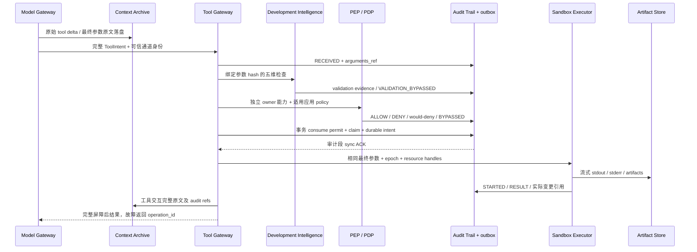

# 内部协议 v0.2 — M0.1 增量

继承 [M0 全文](../../AgentNexus-v0.4-M0/architecture/internal_protocols.md) 的身份、单次许可、epoch、消息与恢复约束；本文件补充/细化的条款优先，原文不改。实现状态见 M1 报告，不把设计接口当已部署服务。

## 数据实体和交接

`OperationIdentity {operation_id,event_id,agent_id,project_id,task_id,session_id,correlation_id,causation_id}`；可信 Host 生成操作/事件 ID，并从认证会话填 actor。任何参数改写必须新 intent_sha256、重新诊断/授权，不重用旧 permit。

`CommandSpec {executable_ref, argv:string[], cwd_resource, stdin_ref?, shell_script_ref?, dialect?, environment_profile_ref, expected_workspace_revision}`。exe 不经 shell拼接；PowerShell/Bash AST 只诊断，不据解析器认定命令安全。动态命令/alias/eval 无法静态求值标 INCONCLUSIVE，不调用用户CLI的 --help 来“验证参数”（它可能执行项目代码）。

`ValidationResult {request_id,uri,version,source_sha256,checker_id,checker_version,dimensions:{syntax,args,environment,safety,authorization},diagnostics,evidence_refs,status,reason}`；每维状态为 PASS/FAIL/NOT_RUN/INCONCLUSIVE/BLOCKED/BYPASSED。检查关闭 reason=VALIDATION_BYPASSED；授权永远由 PEP 填，DIE 不可签批准。诊断结果同时绑定 feature_epoch/config revision；执行前必须重查开关/参数，旧诊断不能认可新代码。

`AuditEvent` 必备字段见 [Audit Trail](audit_trail_design.md)；`ContextRecord {event_id,session_id,sequence,payload_ref,audit_event_refs,previous_hash}`；`ArtifactRef` 与 `DecisionRecord {decision_id,status,authority_ref,supersedes,evidence_refs}` 分开。无可用加密能力时拒绝 secret payload，不把机密明文存普通对象。初版不扫描用户 Key。

`SandboxCapabilities {profile_revision,platform,admin_identity_verified,filesystem,network,process_tree,read_only,verified_test_refs}`；枚举各能力 SUPPORTED/UNSUPPORTED/NOT_RUN，不用一个sandbox=true汇总。`Sandbox.prepare/execute/cancel/reconcile` 回执含 PID+start identity、tree_exited、资源句柄身份、网络实际 profile。缺任何请求所需能力则 BLOCKED，无自动 unsandboxed fallback；Policy DISABLED 也不能改变它。

## 必须闭合的故障窗口

| 窗口 | 合同 |
|---|---|
| 模型流尚未完结 | 不执行半个参数；原始 delta 完整保存，超限显式中止 |
| audit/context/artifact 任一必要写入失败 | 不发执行许可；已经执行但结果未归档则 INDETERMINATE/恢复，不返回普通成功 |
| DB 状态与审计段不同步 | 同库 outbox、序列/hash 去重导出、重启 reconcile；跨文件不宣称原子 |
| Feature OFF 后异步检查完成 | epoch fence 丢弃迟到结果；取消自有检查器，绝不隐式再启动 |
| PDP 故障 | ENFORCE/AUDIT_ONLY 阻断；已手动 DISABLED 的选定条款不调用PDP，但不关闭审计或独立owner |
| 过期/消费过/不同参数 permit | 事务拒绝；重启不重置 max_uses/nonce；时钟回拨冻结 |
| 多 Agent 写同资源 | 同库 writer claim + fencing + expected hash；旧执行树未证退出不换 writer |
| 进程超时/结果未知 | cancel request 不是成功终止；retain claim，人工/专用 reconcile；不自动再执行 |

## M1 接口冻结和部署限制

首批代码是零 npm 依赖的 Node 24.15 本地库/测试入口，TypeScript 使用 Node 原生可擦除类型。没有 Agent 网络服务、管理员HTTP API或桌面服务。库内将可信控制句柄与 Agent 门面分开，challenge/双确认/版本/期限真实持久化；它不能证明 OS peer 身份隔离。部署准入明确 BLOCKED，直到 Windows/Ubuntu 各自管理员身份与绕过门通过；不能给模型加载本机 Host 模块或控制句柄。

M1 注册实际存在的模块；未实现的108项历史定义和新增项保留能力目录，但 effective=BLOCKED/NOT_IMPLEMENTED，不按产品默认ON偷偷运行。Diagnostics 的固定可信解析器进程不接受用户可执行程序、启动脚本或项目插件，源文本走 stdin；禁止用户代码求值。普通工具首批可执行纯计算、归档读取、受控合成对象；自由 shell、文件系统任意写、Git发布、外部Harness、科研入口在系统边界未验收前拒绝。
