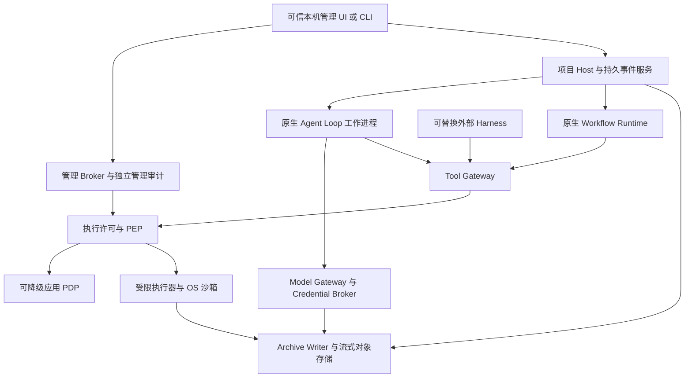

# AgentNexus 内部协议 v0.4 M0

本文是M0设计规格，所有接口均为拟实现。协议与数据归AgentNexus所有；外部Harness只做转换。实现不得把供应商的thread、tool或OAuth对象直接当全系统主键。

## 可信边界与调用方向



图表示能力边界，不要求每个方框一个常驻进程。首版三个安全域：可信Host/Broker、受限Agent/工具、低权限Studio renderer。Native Helper仅封装必须的OS原语。可选业务模块可同安全域合并进程，第三方插件/MCP不能进可信Broker地址空间。模型结果、项目文件、上游AGENTS、网页、工具返回均不可信。

常规IPC使用版本化JSON消息和独立二进制流；本机Windows优先有ACL的命名管道，Unix域套接字为移植路径。管理通道与Agent通道分开，校验OS peer身份及短期能力；仅绑定localhost或持有项目目录文件不能视为管理员认证。若提供HTTP兼容端口，必须显式鉴权、Origin/CSRF检查与关闭默认网络监听。当前未实现这些保证。

## 公共封套与版本协商

```ts
type Ref = { uri: string; sha256: string; bytes: number };
type Envelope<T> = {
  schema: "agentnexus/0.1";
  message_id: string; correlation_id: string; causation_id?: string;
  project_id: string; task_id?: string;
  payload: T; payload_ref?: Ref;
  expected_revision?: number; idempotency_key?: string;
};
type Error = {
  code: "UNAUTHENTICATED"|"FORBIDDEN"|"REVISION_CONFLICT"|"FEATURE_OFF"|
    "DEPENDENCY_DISABLED"|"POLICY_UNAVAILABLE"|"APPROVAL_REQUIRED"|
    "LEASE_STALE"|"BUDGET_EXHAUSTED"|"BACKPRESSURE"|"ARCHIVE_UNAVAILABLE"|
    "INDETERMINATE_EFFECT"|"UNSUPPORTED_CAPABILITY"|"SCHEMA_UNSUPPORTED";
  retryable: boolean; event_ref?: Ref; safe_detail: string;
};
```

封套不接受可信actor或admin标志；Broker从经过认证的通道推导身份。ID为不透明值，路径不是身份。握手声明协议版本、能力和最大frame；未知主版本拒绝，未知必需字段拒绝，不静默兼容。消息JSON上限1MiB，较大payload使用Ref与分块流。初始值均是待压测的设计预算：传输块64KiB，单流队列上限4MiB、总写入队列64MiB；达到高水位则await drain/拒绝新运行，不能无限追加数组。每个stream有credit、sequence、cancel、已持久化offset；不把模型可见截断当原档案截断。

## 身份、五类系统角色与工作角色

```ts
type Agent = {
  agent_id: string; project_id: string;
  system_role: "RESIDENT"|"LEAD"|"SUBAGENT"|"BACKGROUND_REVIEWER"|"COORDINATOR";
  work_role?: "SCOUT"|"WORKER"|"VERIFIER"|"REVIEWER"|"CONTEXT_RETRIEVAL"|string;
  parent_id?: string; contract_ref: Ref; capability_set_ref: Ref;
  state: "CREATED"|"READY"|"RUNNING"|"WAITING"|"PAUSED"|"RECOVERING"|
    "COMPLETED"|"FAILED"|"CANCELLED"|"BLOCKED";
  revision: number;
};
```

| 系统角色 | 确定性职责与LLM边界 | 消息和隔离 |
|---|---|---|
| Resident | 持久化、投递、心跳、唤醒由服务执行；语义助手可关闭 | 先落盘后ACK；无需持续LLM轮询；不批准权限 |
| Lead | 项目方案和任务整合；自动规划可关闭 | 一次一个活动Turn；等待子任务时收件箱仍可投递 |
| Subagent | 有范围、输出、预算的专门工作 | 默认独立上下文、独立写工作区；仅合同和明确证据引用；默认派生深度1 |
| Background Reviewer | 审查候选快照；自动触发可关闭 | 独立会话、只读候选；不与作者共享完整推理；不自动修代码 |
| Coordinator | 跨任务资源决策；普通配额由确定性调度器执行 | 不改项目代码/研究方向；关闭后静态配额；不得越权增预算 |

系统身份可以跨Session和进程持续存在。WAITING释放模型槽；唤醒只排队一个READY信号。逻辑“手工派发”表示可信用户发起，不允许模型通过换工具名把auto-spawn OFF变成自动派发。

## Task、Session、Turn和执行账本

Task包含goal、范围allowlist、父子关系/DAG依赖、验收条件、预算、授权引用、work_role、workspace_ref和结果证据。完整工作合同关闭时仍必须有最小task_id、goal、scope、owner、status；不能丢掉追踪身份。状态变更带expected_revision，条件更新与状态事件/outbox同事务。

Session保存agent_id、harness_id、model_profile_ref、archive_cursor和context_view_revision。Turn保存session_id、run_id、input范围、model_request_id、feature_epoch、policy_epoch与终止原因。每个Agent最多一个活动Turn由唯一索引/租约保证；进程PID仅是运行属性，并绑定启动时间与OS进程句柄，防PID复用。

执行账本为 `PREPARED → CLAIMED → STARTED → SUCCEEDED / FAILED / CANCELLED / INDETERMINATE`。不可重复任务claim具有唯一业务键和不可重置状态。工具超时先CANCEL_REQUESTED，确认整个进程树退出、回收句柄及旧writer fencing后才可启动新写者。UNKNOWN/INDETERMINATE进入人工核对，不用删除claim或无条件重试恢复。取消是请求，已完成副作用不能被改成“从未执行”。

## 可靠消息与事件

Agent消息类型包括TASK_ASSIGNED、QUESTION、ANSWER、PROGRESS、BLOCKED、FINDING、RESULT、REVIEW_REQUESTED、REVIEW_COMPLETED、APPROVAL_REQUIRED、CANCEL、HEARTBEAT。信封再带source/target/channel、expires_at、priority、delivery_attempt和dedup_key；可信source由服务填写。

单库事务写状态与outbox，投递至少一次。消费端 `(consumer_id,message_id)` 唯一，成功应用状态变更和去重记录同事务。持久化后ACK，失败退避有上限与死信；不承诺外部副作用端到端exactly-once。跨项目消息需明确管理员授权；不能借用另一个项目的预算、档案或凭证。

原始Event另含event_id、session_sequence、observed_at、source_kind、run/tool_call_id、payload_ref、previous_event_hash、event_hash、schema_version。每个Session单一顺序写者；跨Session只给因果关系，不伪造全局物理时序。事实更正追加correction事件；投影可重建，不能改事实。

## Tool Gateway、Policy与Approval

ToolDefinition包含id/version、input/output Schema、risk、read/write/network资源类别、timeout、cancel语义、output流、幂等类型和reconcile接口；工具自报readonly只用于展示，不授予权限。

```ts
type ToolIntent = {
  tool_id: string; tool_version: string; call_id: string;
  arguments_ref: Ref; contract_revision: number;
  resources: { resource_id: string; operation: string }[];
  expected_workspace_tree?: string;
};
type ExecutionPermit = {
  permit_id: string; subject: string; intent_sha256: string;
  resource_handles: string[]; nonce: string; max_uses: 1;
  expires_at: string; feature_epoch: number; policy_epoch: number;
  approval_id?: string; budget_reservation_id?: string;
};
```

ToolIntent是请求，不能携带可自行决定权限的mode。Broker规范化参数及真实资源、验证身份和Feature epoch、调用适用PDP，得到ALLOW/DENY/REQUIRE_APPROVAL；策略服务错误返回POLICY_UNAVAILABLE，不能转换为allow。ENFORCE所需的人类批准由可信Approval Service签发，绑定主体/项目/Task、精确action/resource、参数哈希、policy revision、次数、期限和nonce。执行器原子消费许可，并再次校验epoch、撤销状态和资源句柄；禁止检查路径后再用可替换字符串路径重新打开。

副作用前追加durable intent，副作用后追加完整结果与资源实际状态；许可消费与意图同数据库事务。OS副作用与数据库不能原子提交，崩溃窗口必须通过reconcile识别真实结果。未知结果不得发第二次许可盲重试。重试仅允许可证明幂等的操作，或使用上游认可的幂等键。

模式切换使用独立 `PreparePolicyModeChange → ConfirmChallenge → CommitPolicyModeChange`：scope、reason、target_mode、expires_at、restore_target、expected_revision、impact_ref及管理员peer绑定的一次性challenge。Agent API没有这些方法。切换先冻结新副作用，在途请求完成/取消并核对，递增epoch撤销旧许可。模式/审计在独立管理数据库同事务提交；文件导出审计不能假装与另一个数据库原子提交。到期立即封锁旁路新操作，进入ENFORCE_PENDING_PREFLIGHT，通过预检后恢复；失败继续封锁。细节及逐条实际效果见[Policy Catalog](policy_catalog.md)。

## Feature Registry与Workflow Runtime

`GetFeatureDefinition / ResolveEffectiveFeature / PreviewFeatureChange / CommitFeatureChange / RecoverModule` 均输出config_revision、desired_state、effective_state、epoch、依赖闭包和健康。Preview不更改状态；Commit需管理员、expected_revision、精确预览哈希与有效期。关闭不删除历史；OFF后不再注册工具/定时器/监听器/后台任务。模块持有owned work清单，取消超时为QUIESCING或FAILED，不能假报DISABLED。依赖闭包全量原子禁用或拒绝变更，不产生隐式自动启用。

Workflow定义原生RuleSpec、RoleProfile、GateDefinition、ArtifactSchema、EvidenceBinding、ReviewContract和Validator。规则加载产生类型化约束和有来源的可选提示；能够机械执行的规则编译到Broker约束，不依赖Agent自行读文档。G0—G6按[原套件映射](workflow_kit_mapping.md)语义实现，不能凭名称重新定义。每个Gate的Result含gate_id、candidate_ref、rule_revision、test_profile_hash、status、evidence_refs。状态只允许PASS、FAIL、NOT_RUN、INCONCLUSIVE、FAKE_ONLY、BYPASSED。关闭Gate写BYPASSED及原因，未执行绝不写PASS。

Source provenance映射不等于运行依赖：原ZIP只读归档，运行时不解包原件、不运行manage安装器、不写AGENTS或hooks。模板转换为类型化表单/JSON实体与渲染器；源文件缺许可证使代码/原文直接移植准入保持BLOCKED，独立规格重写见ADR。

ReviewResult绑定candidate_tree_sha256、baseline、author_identity、reviewer_identity、rule_revision、test_profile_hash、evidence集合及真实测试状态。任意绑定改变使旧批准不适用；作者不能签自己的独立审查。Git集成仍是单独ToolIntent，自动review关闭不自动授权merge/commit/push。

## Archive的提交、压缩和检索合同

1. 捕获可观察原始内容，流式写独占临时object并刷盘，计算内容哈希。秘密由Credential Broker注入上游，不经Agent；意外敏感原文单独AEAD加密并收紧ACL，普通档案保存引用和脱敏视图。完整原文可由具备权限的管理员读取，不能以脱敏摘要替换或丢失原文。未知秘密检测不能宣称完美。
2. 原始事件按帧长/序号/校验追加到活动spool并刷盘。Session单写者，保存durable offset与前哈希。半条尾记录隔离，只恢复完整校验记录；不得把已确认事件当普通坏尾截掉。
3. 元数据索引和outbox在一个SQLite事务提交。只有object、原档案和元数据达到提交屏障后才对外ACK。文件与DB无跨介质原子性：崩溃留下的未索引完整记录通过序号/hash补入；只有object但无事件的孤儿隔离保留；数据库指向不存在/损坏已确认记录时停止并报告恢复问题。
4. 达到段预算（初始提案16MiB原文或60秒）后封段，流式Zstandard压缩，记录codec/版本、字节数、序列范围、前段hash及压缩前后sha256。解压逐块验证原文hash，刷盘后发布manifest，再提交索引切换。活动段保留到新表示验证与恢复点发布，压缩只是同一原文的表示变化。禁止仅凭压缩写完就删唯一原件。
5. 原始blob/段不可被模型或摘要服务写入。哈希链只能检出篡改，不能抵御拥有签名密钥和磁盘控制权的机器管理员；可选独立备份/签名提供额外证据。

`Archive.Append / Flush / ReadRange / Query / Verify / Export / Reconcile` 中Append仅限可信捕获入口；其他服务提交意图而非直写磁盘。ReadRange返回archive_id、event_id范围、UTF-8字节offset、内容哈希与访问审计。Query分页、可取消，有扫描/模型Token预算。检索Agent只能读授权范围，返回结论、原文精确引用、检索条件、缺失与冲突；不能把推断当原始事实。

Summary/向量/知识条目包含source_event_ranges、generator/model_revision、created_at、validation_status、可选confidence；全部可删除重建，不代替raw。原始档案不是模型的隐藏推理或供应商未返回内容；只承诺完整保存系统实际观察到的交互/状态/工具输入输出和分块流。模型窗口无法容纳规则和必要证据时暂停并分批检索，不静默裁掉关键规则。

## Model Gateway与凭证池

实体分离：Provider、Account/Project、CredentialRef、Pool、Model、ModelProfile、RoutePolicy、UsageRecord。Agent发profile/model请求与能力需求，Gateway选择实际供应商；worker/renderer只持引用，不接触Key。外部产品OAuth登录由其Adapter独立管理，不能推定能加入通用API池。

`Generate / Cancel / ReconcileUsage / ReserveBudget / CommitUsage / ProbeCapability` 返回标准化TextDelta、ToolCallDelta、Usage、Finish、ProviderError；保留供应商原始响应为受限原始payload，不把OpenAI-compatible当全部能力兼容。工具参数必须等完整流片段通过Schema后才执行。profile强制需要但模型不支持的能力返回UNSUPPORTED_CAPABILITY，不悄悄降级。

预算按全局→项目→Agent→Task→Provider Account预留，使用整数最小计费单位与明确有效期价格来源。预留输入最大可计费量与输出硬上限，实际费用结算，未知账单暂留预留并对账；不能许诺供应商最终账单绝不多于本地估算。Key轮换、自动路由、跨供应商failover分别开关；同Account共享限额不因换Key归零。429、认证错误、5xx、超时分别处理；已发送但结果未知的付费请求不盲重发。

## Workspace、Git与恢复

Workspace引用真实仓库身份、baseline、branch或独立副本、tree hash、OS执行身份、writer租约和fencing token。只读Agent用快照，写任务独立worktree/副本；共享Git对象、hooks、配置、替代对象库、凭证helper均是额外通道，worktree本身没有安全隔离效力。Git动作使用受控环境、明确仓库/远程/分支/SHA，不根据工具输出任意执行下一条命令。

Checkpoint包含Agent/Task/Session、合同/规则/Feature/Policy版本、档案cursor、树哈希、未确认消息、预算预留、活跃进程身份、在途ToolIntent和需核对的外部动作。恢复先查OS进程、锁与实际副作用，重建投影，再重投递消息；不能因为最后模型说“完成”就提交结果。核心状态故障时暂停相关动作，可选索引/通知故障不拖垮独立任务。队列、WAL、磁盘、RSS、句柄/子进程数按项目限额；初版soak和强杀验证见[实施计划](implementation_plan.md)。
