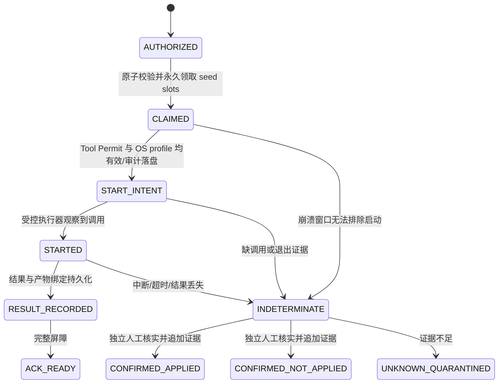

# M1.2 科研实验授权合同（P1-D）

状态：DESIGN_ONLY / 运行验收 NOT_RUN。未连接 AI_Consciousness、AI_NeuroWeave、AI_Highlycomplex 或其他研究项目；没有训练、调用模型、换 seed、修改既有实验合同或产生外部费用。

## 三种授权分别成立

| 合同 | 授予内容 | 不因此获得的权限 |
|---|---|---|
| Tool Permit | 已批准精确工具意图的一次执行，绑定 actor/hash/epoch/期限 | 实验协议批准、seed Claim、OS 进程/文件/网络权限 |
| Experiment Authorization | 指定协议/条件/seed/训练单元/实验臂的科研资格和预算范围 | 任意工具执行、Provider Key、OS 管理或新实验臂 |
| OS Execution Profile | 真实 UID/token、资源句柄、网络和进程限制 | 科研资格或对具体副作用的人工批准 |

实验执行必须三者同时有效，并先完成独立的费用/数据使用许可。通过普通工具审批、把 mode 改 DISABLED 或提示词里写“已批准实验”，都不能形成实验授权。

## 不可变协议与数据合同

拟定实体由可信科研授权服务持有；不把以下 JSON 当已实现接口：

```text
ProtocolRef {study_lineage_id, protocol_id, version, sha256, byte_length,
  canonicalization_version, raw_protocol_artifact_ref, supersedes_protocol_ref}
ConditionRef {condition_id, condition_sha256, dataset_manifest_sha256,
  preprocessing_sha256, training_code_sha256, environment_profile_sha256}
SeedRef {seed_id, rng_algorithm, rng_version, exact_seed_value, namespace}
TrainingUnit {unit_id, protocol_ref, condition_ref, seed_ref,
  sharing: SHARED_TRAINING | INDEPENDENT_TRAINING, training_family_id,
  planned_arm_ids, evaluation_stage_ids, resource_budget}
ExperimentAuthorization {authorization_id, revision, protocol_ref,
  plan_sha256, allowed_training_units, actor_scope, resource_budget,
  valid_from, expires_at, approver_identity, reason, evidence_refs,
  signature_or_broker_ref, max_claims, revocation_revision}
SeedClaim {claim_id, authorization_id, authorization_revision,
  stable_seed_slot, training_unit_id, exact_plan_sha256, claim_nonce,
  claimed_at, state, operation_ids, writer_fence}
ExperimentArtifactBinding {artifact_ref, authorization_id, claim_id,
  protocol_sha256, condition_sha256, seed_id, training_unit_id, arm_id,
  stage_id, parent_checkpoint_ref, operation_id, intent_hash,
  tool_version, source_sha256, dataset_sha256, environment_profile_sha256}
```

协议保存原始字节和明确规范化算法；只签版本号而缺 SHA256 不够。任何条件、臂、数据、代码、共享训练语义或预算变化都需要新的精确计划及人工批准，旧授权不能“默认兼容”。哈希验证只证明字节绑定，不证明科学结论正确。

`seed_id` 是固定算法/版本/精确数值/命名空间的持久身份，不是任务序号、文件名或可自由替换参数。稳定 Claim 业务键建议为 `(study_lineage_id, condition_identity, seed_id, training_family_id)`；协议修订继承原 seed slot 映射，不能用换版本/换 task/换 authorization_id 清除旧 claim。更改 lineage 或新增真正的重复研究，须由独立人工明确批准并标记研究关系，不由代理生成新 ID 绕过一次性约束。

## 同 seed 多臂共享训练

SHARED_TRAINING：为完整臂集合一次性领取一个训练 Claim，只训练一次，产生唯一不可变 checkpoint；各臂评价消费同一 checkpoint 引用。臂与阶段分别有唯一业务键，不能每个臂都把“共享”当作重新训练许可。共享训练参数、数据预处理和停止点必须在协议中完全一致。

INDEPENDENT_TRAINING：协议必须显式说明各训练单元、臂和 seed slot，预算按真实训练次数批准；不能在运行中把共享训练自动拆成独立训练。反向合并同样需要新计划。臂失败不触发重训，也不将其他臂结果冒充该臂。

## 原子领取与执行状态机



同批并行任务采用一次数据库事务检查授权版本、期限、精确计划、预算、全体 seed slots/臂集合、Claim 唯一约束，再写全体 Claim 与审计 outbox。任何一项冲突则整批回滚，落盘前不启动任何训练。执行器起跑前再次消费操作 Permit、检查授权撤销版本与 Writer fence；事务外的训练/上游副作用仍存在未知窗口，不承诺端到端 exactly-once。

授权过期只能阻止新起跑，不能将永久 seed Claim 释放成可重领。取消/失败/中断保留原 Claim、原日志和 partial 产物；超时先请求停止，等待真实进程树和产物写者退出。UNKNOWN 保留预算/资源隔离，不启动另一臂训练、不换 seed、不自动重跑。

CONFIRMED_NOT_APPLIED 也不自动重发。若未来研究合同允许人工重新尝试，必须有独立的异常授权实体、原 Claim/裁定引用、明确 attempt_id、次数与理由；不能删除/重置一次性 Claim。本轮不实现异常重跑 API，也不默认批准这种例外。

## 产物、审计与独立裁定

每个 checkpoint、指标、原始输出和失败结果都绑定原授权、协议 SHA、condition、seed、训练单元、臂、阶段、精确操作及父 checkpoint。接收端拒绝错臂/错 seed/缺父产物/混用协议版本；只追加新版本，不覆盖原结果。派生图表可重建，不能取代原始实验事实。

科研裁定者与执行 Agent 分离；裁定请求绑定原 Claim、原 intent、原协议和证据，使用单次能力与 expected_revision。无证据不能解除 UNKNOWN；人工确认结果和 OS 退出确认分别审计。独立科学审查不能由代码作者/执行 Agent 自签；无测量证据的科学主张为 INCONCLUSIVE。应用 Policy 三模式不影响一次性 Claim、原始事实或授权服务。

## 验收测试计划（全部 NOT_RUN）

| 编号 | 真实条件与预期不变量 |
|---|---|
| SCI-01 | 改协议字节、条件、臂、代码/数据 SHA、seed 任一字段，旧授权拒绝 |
| SCI-02 | 16 并行领取同 seed slot，唯一一方成功；跨 task/版本不重置 Claim |
| SCI-03 | 批量多 seed/多臂中一个冲突，零训练启动且整批领取回滚 |
| SCI-04 | 共享训练完整臂集合只训练一次，所有臂绑定同一真实 checkpoint |
| SCI-05 | 共享/独立语义改变、部分臂失败，均不自动重训或补臂 |
| SCI-06 | Claim 前、START_INTENT 后、训练后结果前、RESULT 后 ACK 前强杀，重启不重跑 |
| SCI-07 | 租期到期/取消/未知退出保留 seed Claim、资源与原始失败证据 |
| SCI-08 | 错协议/seed/臂/parent_checkpoint 的产物拒绝，不覆盖原档案 |
| SCI-09 | Tool Permit、OS profile、科研授权缺任一种都不能启动 |
| SCI-10 | 无证据/错误 intent/裁定重放/并发裁定/执行者自批均拒绝 |
| SCI-11 | CONFIRMED_NOT_APPLIED 不自动重发；新 attempt 必须有独立明确异常授权 |
| SCI-12 | 真实管理员/Worker 隔离与费用未知核实分别验收，不以模拟结果代替 |

后续实施应先在专用合成训练服务验证状态机，实际科研数据、真实 Provider 和正式训练须另获范围明确的授权；本合同不改变任何已有科研协议。
