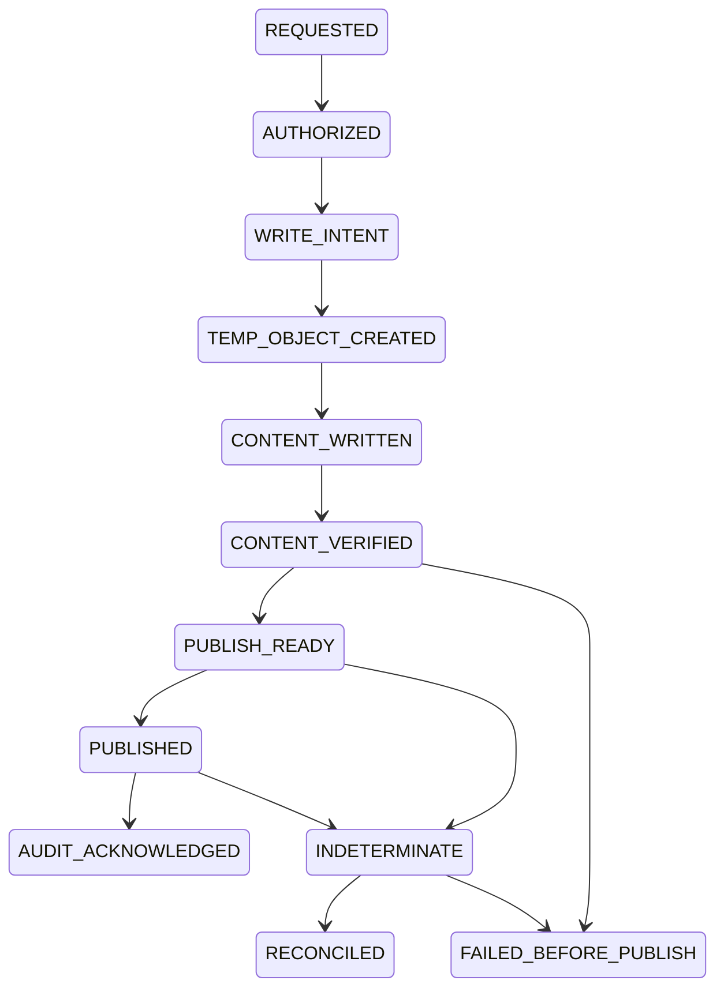

# 持久 Storage Owner

实现：`source/src/agentnexus/harness/storage-owner.ts`，通过原 Tool Gateway 的 `native.storage.write@1` 执行；普通 Agent 仅持有受限门面，不能取得 Store、SQLite、Storage Owner 或管理 token。严格 CPU 与生产 OS 资格保持 BLOCKED。

可信 Host 注册独立的 managed resource root，并绑定 project、可选 task、quota 与最大文件大小。路径采用相对规范格式，拒绝重解析点、目录身份变化和管理目录重叠。这里的目录由可信本地 Host 管理；Node 路径检查不是恶意同账户进程的 OS 隔离。真实 Windows 句柄边界的测试属于独立 File Broker 资格。

请求精确冻结 resource、path、CREATE/REPLACE、原版本与 SHA256、完整 immutable ContextSource。Operation ID 由原 Gateway 在调用前生成；Owner 核对 CLAIMED operation、consumed permit/approval、intent hash、身份与活动任务磁盘预留。内容来自同项目/授权任务的原始 Artifact，不能拿任意文件路径或外项目 Artifact 冒充输入。

每次状态提交沿用 NativeState → SQLite FULL/WAL → durable audit outbox → export flush。SQLite 事务不被描述为文件系统事务。写前 intent 先持久 ACK；临时文件在目标同一目录以 `wx+` 创建，64 KiB 分块、逐块等待写入、文件 sync、完整重读 SHA256/大小/身份核对。首次 CREATE 使用 hardlink 的原子 no-clobber 建名并删除 owned temp；REPLACE 只接受 Owner 已知的精确 version/hash/identity，通过同目录 rename 原子替换。现存非 Owner 文件不能被覆盖。

发布前再次核目录、旧版本、Feature/Policy epoch、取消 Signal。发布后核新文件身份与内容；Audit ACK 前再核一次实际文件，防止“发布过正确内容”被误当作“确认时仍是正确内容”。成功 ACK 同一 SQLite 事务更新 version、path claim、write 状态和含 Artifact/Context 引用的 Audit。旧版本原始 Artifact 保留。

Artifact Store 存真实 immutable 内容；Context Archive 存原始经历与输入；Audit Trail 存操作阶段与关联；Decision Ledger 只存正式决定，文件发布不伪造决定。跨模块以 intent、outbox、ACK 与显式 reconciliation 协调。

磁盘转交由 `BudgetManager.adoptStorage` 核对实际 Owner ACK、已导出审计、Gateway SUCCEEDED/SETTLED 和原 reservation。Worker 退出前把已发布容量转为 Project/Platform 的 `resource_storage_claim`；释放 Worker 不会释放持久磁盘。版本保留采用保守计费，尚无自动 GC/销毁释放机制。

并发 Owner 操作最多 2 个；资源最多 32 个；写操作最多 4096 个；文件上限 64 MiB；资源上限 1 GiB。Artifact 共享写入最多 2 条活动流和 16 条等待；旧 `put` 的第三流直接拒绝合同不变，Harness 显式使用 queued API。队列数量有界；等待时长由调用方取消/截止控制，不能把等待队列称为定时完成保证。

精确入口与完整断言见 `m161-storage.test.ts`、`m161-artifacts.test.ts`、`m161-harness.test.ts` 和最终原始回归记录。
