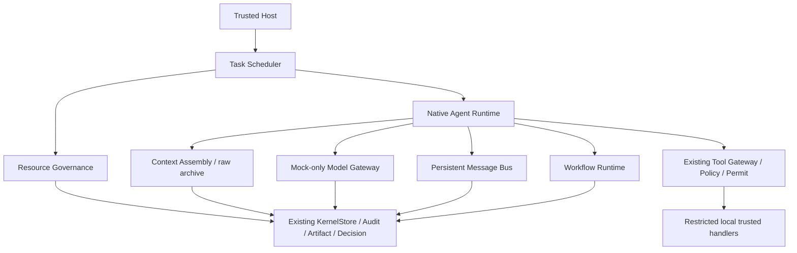

# M1.6 总体架构与实施边界

设计版本 2026-11-08（Asia/Shanghai）。基线是 M1.5.1 独立 source 的100个文件，逐文件SHA256与原清单相同；根M1.3不升级。此版本选择可运行的可信本地Harness作为最小闭环，真实恶意Worker的OS隔离、生产Windows链和严格累计CPU保持BLOCKED。

统一可信Host拥有原KernelStore、FeatureRegistry、PolicyEngine、ToolGateway、Context Archive、Artifact Store、Decision Ledger和Reconciliation。新增模块只扩展同一数据库中的有版本投影；状态变化与原Audit/outbox同事务，导出sync之后才执行下一步。模型、项目文件和Agent消息都是输入，不能取得管理能力。

A线实现Worker/Project/Platform预留、消费、等待、释放与UNKNOWN隔离。CPU bandwidth、consumption、wall deadline、accounting使用独立能力合同。预算账本的应用层拒绝不能宣称OS硬限制；CPU_RATE不是累计CPU预算。

B线实现五种Agent类型、可信生命周期、单Agent活动turn、持久有界任务队列、DAG依赖、取消/暂停/交接/恢复、带来源的上下文、双向消息、模拟Provider和原生工作流。Resident空闲只保留持久等待状态；不会轮询模型。Reviewer/Coordinator只读，不授项目决定权限。Subagent从主Agent捕获的合同中分配独立任务/上下文/预算；模型能力不会增加权限。

模型工具请求始终调用原Gateway，参数验证、Feature、Policy、精确审批、Permit、Audit屏障保持。LOCAL_WRITE只能由管理员批准精确intent；PROCESS/EXTERNAL_EFFECT继续拒绝。模型不能修改规则、策略、身份、预算或生命周期投影。

范围可调整但不等待次要选择：此轮不部署系统对象，不读取密钥，不接真实模型，不运行科研，不自动Commit/Push。完整生产能力需要独立资格与后续授权；本轮的模拟闭环明确标SIMULATED。
