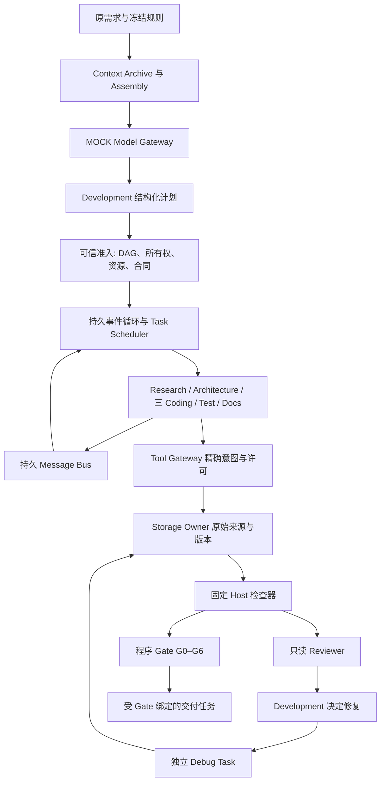

# M1.7 总体架构

所有模型输出由明确标记的 Codex 编写模拟策略提供；以下 PASS 仅表示实际本地运行与断言通过，不表示真实模型自主研发通过。

增量沿用 M1.6.1 的存储、来源、消息、规则和 Gate 内核。引擎只改 models/index/scheduler 与 package 版本；新增 development/event-loop/pilot-checker/pilot-fixtures/pilot-run、7 组测试与3个入口。根目录旧产品不被替换。

模型只能给提案和工具意图。可信 Host 校验同一 Task 历史中的原模型结果与原需求引用，准入有界 DAG，分配独立 Agent/runtime/task/context/model/budget/资源范围。拒绝大小写路径别名、原型名称、目录前缀冲突和无原始上下文的伪造计划。通过实际获准计划设置任务目标、依赖、产出、模型策略和预算。

事件层是持久有界控制面：历史512、待处理256、并发默认3且上限4。没有常驻模型轮询；只在内部事件/消息/期限唤醒。重开不会自动恢复 DISPATCHING，先转 INDETERMINATE，明确恢复后再启动；UNKNOWN 不自动重试。普通 Agent facade 不暴露 Store、admin、Gate 注册或权限修改入口。

每次代码发布都走不可变原始模型回复 → Gateway stage → 精确路径与内容批准 → G1 → Storage Owner。候选每文件不超过64 KiB、合计不超过1 MiB；固定 Runner 在独立快照上用已固定 Node/TypeScript、固定参数与最小环境检查。它只允许已登记 fixture 内容，不是任意代码沙箱，也不授予普通 Agent PROCESS。

多文件交付是逐文件发布后整套再校验，不声称多文件原子事务。逻辑预算和可观测进程关闭不等同 OS 硬限制；CPU/生产执行资格保持 BLOCKED。代码生成 fixture 是 Codex 工程输入，真实本地执行链与通用模型智能的证据必须分别阅读。
