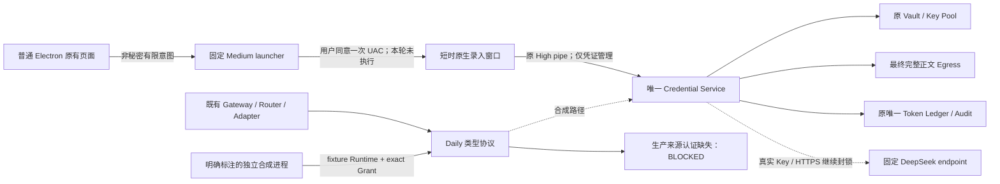

# M1.8.3-Q2 双通道架构与资格边界

本包为独立代码候选与离线验证交付。**整个 Q2 未完成，生产 NO-GO。** 通道 A 有原生可信录入程序、有限启动器、服务票据与原页面集成，但尚无实际 UAC/独立服务/内存保护资格。通道 B 有可执行的受限协议与服务端一次性精确 Grant、账本事务、独立合成进程集成；**没有生产 native Runtime 身份认证器和 Medium listener**，普通 Host 始终收到 IPC_BLOCKED。部署此包也不能开启日常真实请求。

## 可信根与普通 Host

Windows、经独立批准的部署者/签发者、受保护安装和独立服务身份为待验证可信根。交互用户同 SID 的普通程序属于攻击者。PID、进程名称、路径、SHA256、Role、自报 SID、PUBLIC 标签都不授予权限。现有 Electron、Harness、Gateway 和 Adapter 沿用，未重新开发 Agent Runtime。普通 profile 放入用户 AppData，仅保存无凭证元数据。

High 通道的原 DACL `D:P(A;;GA;;;SY)(A;;GA;;;BA)(A;;GA;;;<service SID>)`、`S:(ML;;NW;;;HI)`、first-instance、remote reject 均保留。Q2 将连接程序进一步限制为固定 helper，废除普通 Host 启动通用 High stdio client 的路线；native 与 Node 两层限制 helper 方法，不能执行 broker、budget、HTTP、命令或读回凭证。

## 通道 A

Add Key 保留原位置，但 Renderer 只收 Provider、模型范围、名称和固定动作；不再创建密码输入或发送 secret。普通 launcher 验证固定自身与安装树，再以固定 runas 调用固定 helper。Helper 独立显示最终 Provider/Model/动作/用途/目标，直接收新 Key，确认后在一个实际 channel 内 prepare/save。操作 UUID 只是关联标识，不能当授权。非授权程序可能要求 Windows 显示 UAC；没有用户同意和可信窗口确认就不能完成管理。不能声称 UI 发起者已由进程名认证。

票据 30 秒、单次、绑定 channel/operation/元数据 hash/秘密 hash/epoch；随机 ticket ID 是 nonce，服务实例内持有记录，重启不恢复。取消可撤销 ISSUED/COMMITTING，断线与异步加密后的最终 fence 生效；轮换拒绝已经 ROTATING/QUARANTINED 的旧目标。退出码只表示有限完成/取消或不确定/阻断，不返回 Key。退出后 Host 重新读投影；不可用时不能编造“已连接”。

完整安装校验覆盖固定 service/client/node/helper/launcher/engine Hash 和完整 app manifest，并由外部 CMS 计划绑定最终 Hash。未提供签发者或完整 Electron 运行时载荷时保持阻断。高完整性本身不证明 VM_READ、线程/token 对象或 dump 保护。Helper 尚未实现这些对象的完整保护；这是代码和 OS 资格缺口，不能只批准安装便声称解决。

## 通道 B

设计比较见 [信任方案](reports/daily-trust-options.md)。可取的后续方向是服务创建并从出生时保护的受限 Runtime，与精确 Grant 组合；需同时解决进程/线程/token 所有者与 DACL、既有句柄、继承、可写依赖、UI 提交意图的独立授权及部署资源。普通进程降权或给同 SID 发一个 bearer token 都不能完成来源证明。

本候选不伪造该能力，也没有配置开关启用它。`DailyGateway.syntheticFixture` 只允许无真实 ServiceBoundary 的合成 Broker。Fixture 的 Runtime 登记属于明确测试权威，生产 native envelope 不接受这些方法；甚至 QUALIFICATION_ONLY 部署也不能走这个登记。可执行协议复用原 Broker、最终 Egress、Vault 和同一 ledger.sqlite。详见 [Daily 协议](reports/daily-ipc-protocol.md)。

## 不确定结果与恢复

Grant 消费、prepared nonce 消费、四层预算预留和请求记录在同一 BEGIN IMMEDIATE 事务内；发送意图先持久化，再交 Provider。失败前能证明 NOT_SENT 才释放预算，已发送/未知 Usage/中断保留 UNKNOWN。服务恢复撤销未消费 Daily Grant，不改已消费记录与 Token 计数；不自动重试。UI 只能展示投影，缺投影用 null/不可用，不展示虚构的真实零消耗。

本轮未安装、提权启动、创建账户、改 ACL/ML/防火墙或注册 AppContainer；真实 Key、真实 Provider 请求与费用均 0。历史同 SID 解密 ISOLATION_FAIL 保留。完整交付资格见 [验收](acceptance-report.md)。
