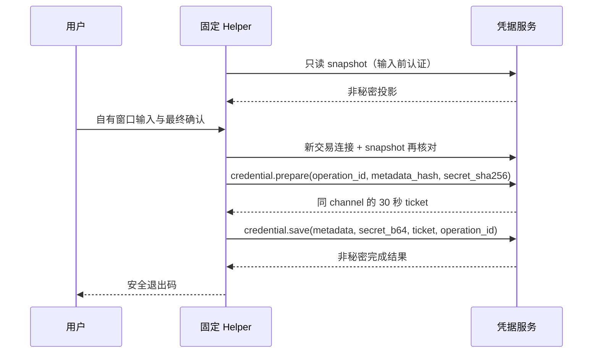

# M1.8.3-Q2 Trusted Credential Helper 技术设计

本交付是短生命周期 Windows Helper 的代码与受限离线验证。编译、纯解析测试通过不代表 UAC、可信桌面输入、服务身份、进程内存保护或 Windows 隔离通过。本轮没有启动提升入口、安装服务、修改账户或 ACL、防火墙、AppContainer、Ubuntu，也没有使用真实 Key 或发送网络请求。

## 范围与固定入口

Helper 源码仅在 `source/native/credential-helper/`，编译复用同一 Q2 的 `native/credential-service/Common.cs`，不调用通用 `pipe-client`，不使用 stdin 转发。唯一部署路径为 `C:\Program Files\AgentNexus\trusted-credential-helper.exe`。二进制为 .NET Framework 4.x、C# 5、x64 WinForms，无下载包依赖。

嵌入 manifest 为 `asInvoker`、`uiAccess=false`。固定 launcher 负责未来的 `runas`；Helper 自身没有提权或启动外部命令的代码，普通 token 不会因自测触发 UAC。正常入口必须通过 `Deployment.Load()`、配置 operator SID 的 elevated/high 非 AppContainer token、自身固定映像路径验证。父级公共实现把 `helper_sha256`、`launcher_sha256` 纳入文件锁定与已签 qualification 的哈希绑定。缺任一部署证据即阻断，不创建输入窗口。

## CLI 非秘密意图

精确参数为：

```text
--action ADD|ROTATE|ENABLE|DISABLE|DELETE|MODELS
--provider-id deepseek
--operation-id lower-case-canonical-UUID
--name NON_SECRET_DISPLAY_NAME
--model-ids deepseek-flash[,deepseek-v4-pro]
[--credential-id key.lower-case-canonical-UUID]
```

每个选项只能出现一次；总计只能为五或六对参数，任一未知、重复、缺失字段直接拒绝。ADD 禁止 target；其余动作要求 target。provider 和 wire model 固定白名单，拒绝重复模型、别名、URL、路径、自定义 wire 映射和大小写变体。模型范围使用 wire ID；Desktop 仅在展示时将其投影到 Registry 内部 ID，不扩大授权。

`--model-ids ""` 仅可用于 DISABLE、DELETE、MODELS；ADD、ROTATE、ENABLE 必须至少一个模型。MODELS 可以明确清空范围，最终复核会显示空范围禁止所有新模型使用。ENABLE/DISABLE/DELETE 的复核模型来自目标当前范围，调用者给的模型提示不改变其 scope。

显示名称是非秘密预填，1–80 个 UTF-16 单位，字符仅 Unicode 字母、数字、空格、点、下划线、连字符，首尾不得有空白，正则使用绝对结束锚点 `\z`。Helper 不提供 secret、stdin、path、URL、command、script、environment 或任意 RPC 选项。operation UUID 只关联事务，不是凭证、授权或安全令牌。非秘密元数据不能保证识别使用者误放进名称的秘密；界面和 Host 必须持续禁止把真实 Key 当作 metadata。

## 自有输入和确认

输入前使用一次只读 direct pipe snapshot，会话验证服务身份后关闭。这样人输入时不会持有超过服务 30 秒 idle 期限的连接。Helper 自己创建 WinForms 窗口，固定显示 Provider、action 用途、允许模型及 target。非 ADD 目标必须来自服务 snapshot，不能仅信任调用者提供的名称或 target。

已有目标的名称使用服务原始 1–80 长度规则，可管理含冒号、emoji 等历史名称。显示时把控制字符、bidi/format、孤立 surrogate 转义为可见文本，并给名称加引号；目标比较仍使用原值。已有模型只作有界 identifier 展示，允许空范围和历史 Registry 内部 ID；这不扩大 CLI 或新写入模型白名单。

ADD/ROTATE 才显示凭据输入框。默认 `UseSystemPasswordChar=true`，关闭快捷复制、剪切、粘贴、撤销和拖放；显式“粘贴”按钮才读取剪贴板。临时显示 15 秒后或窗口失焦时恢复隐藏。凭据只接受 24–4096 个可见 ASCII 字符；QUALIFICATION_ONLY 再要求 `synthetic-test-` 前缀。窗口总生存期为三分钟，取消、关闭或超时均清空输入控件并结束。

最终确认使用 Helper 自建的非秘密复核窗，显示 Provider、模型、显示名称、用途、目标 ID、目标当前名称/状态/模型。默认选择取消，Enter 也取消；明确点击确认后才复制秘密到待发送缓冲区。确认窗受同一三分钟时限控制。管理动作没有秘密输入框。

## 交易管道与协议

最终确认后新建唯一的交易连接。它是有意与输入前的只读 snapshot 分离，不是失败重连；任何连接失败均结束本次意图。交易连接再次 snapshot，检查 policy epoch、运行模式、真实/合成输入权限，以及目标 ID、名称、状态、模型与复核时一致。变化时阻断，不静默跟随新的目标。snapshot 顶层精确接收当前 broker 的六字段形状（含 `daily_gateway`），并验证其独立 Daily 网关状态为固定 BLOCKED；该状态不授予 Helper 管理权限，也不被误报为 Daily 已可用。

每次 RPC 发送前与收到响应后都调用 `Identity.Server`，核对 SCM PID、服务 SID/session、固定服务映像和进程 start identity。服务端每个消息核验 Helper 的真实 token/PID/session、固定 Helper 映像并限制方法集；客户端 JSON 不提供身份。Helper 用 Identification impersonation level，不授予服务 delegation。

ADD/ROTATE 固定 metadata：provider、name、空 notes、models、同值 model_wire_ids、并发 1、每分钟 120 请求，ROTATE 另含 rotate_id。元数据以与 `types.ts canonical()` 一致的键排序 UTF-8 JSON 求 SHA-256；模型数组保留固定白名单顺序。



票据解析严格核对 ticket/operation UUID、剩余期限不超过 30 秒，并加本地单调时钟的使用期限。prepare/save/cancel 始终处于同一交易 channel，票据申请在最终确认之后；本地在 save 前再检查取消与期限。服务最终存储 fence 仍是权威判断。

ENABLE/DISABLE 使用 `credential.state`；DELETE 使用 `credential.delete`；MODELS 使用 `credential.models`。`credential.ticket.cancel` 参数精确为 `{ticket_id, operation_id}`，仅同 channel/operation 生效；父服务实现取消或断线撤销，并拒绝票据重放。取消可能与提交并发，故断线/取消不宣称“绝未保存”。

## 退出与故障

正常执行不写 stdout/stderr、日志、事件、文件或 Host IPC payload，也不返回 Key ID 或 ticket。Host 只能获取安全退出结果并通过独立 snapshot 刷新。

| 退出码 | 意义 |
|---|---|
| 0 | 服务明确确认完成，响应格式与服务身份均复核通过 |
| 20 | 取消、关闭，或 mutation 已尝试后的结果不确定；不得自动重试 |
| 21 | 部署、身份、参数、snapshot、prepare 等前置阻断 |

任一 mutation 开始写出之前即标记“已尝试”；其后异常保留不确定性。prepare 成功而 save 尚未尝试时，尽力在同 channel 发送 ticket.cancel；管道无法使用时关闭连接，由服务撤销。提交期间取消直接断线，最终由 Host snapshot 查询结果；无回放、重连或自动重试。

## 缓冲区与安全限制

控件清空并清除 Undo；可变 clear bytes、canonical UTF-8 bytes、Helper 自己的发送字节数组在 finally 中覆盖，payload 删除 secret_b64 引用。Common 响应帧仅读取服务的非秘密数据。CLR strings、base64/JSON 中间字符串、WinForms/native edit buffer、运行库内部副本无法保证清零；进程退出也不等于不存在 dump 或历史副本。剪贴板读取不保证系统剪贴板、历史或同步副本清除。

High IL 不自动阻止 `PROCESS_VM_READ`，当前 Helper 没有实现和证明严格的 process/thread/token 对象访问保护。因此“可信内存隔离”和同 SID 读取否认资格为 **BLOCKED**，普通桌面窗口也不是 secure desktop 的证明。详见威胁模型；后续资格测试必须在用户单独授权后执行。

## 已执行验证与集成

`source/native/credential-helper/build.ps1` 仅编译、运行 `--self-test` 纯解析/序列化测试，且只有在非管理员 Low/Medium token 与固定 config 缺失同时成立时运行一次缺部署负测。当前实际执行壳是 Low integrity；该负测不得称为 Medium 拒绝、UAC 或服务隔离实测。产物在 `.workflow-kit/runtime/AgentNexus-M1.8.3-Q2/native/`。最终结果与文件 SHA 见 `evidence/helper-native-verification.json`。`helper-canonical-snapshot-crosscheck.json` 来自实际 synthetic Broker.snapshot 和 TypeScript canonical，固定 snapshot 字串嵌入 Helper 纯测试；不读取真实 Key、不发网络请求。本轮 UAC、真实输入窗口和服务/OS 隔离资格全部 NOT_RUN 或 BLOCKED。

父级需持续提供 Common 的固定路径、完整哈希/签名 qualification/锁定链、服务的 Helper-only 身份门禁与有限方法路由，以及 ticket.cancel/断线撤销。Desktop/launcher 已对齐 exact CLI、wire 模型、退出码；其结果不包含任何秘密或安全授权。编译物未安装、未签署、未提升启动，不作为生产可信部署。
