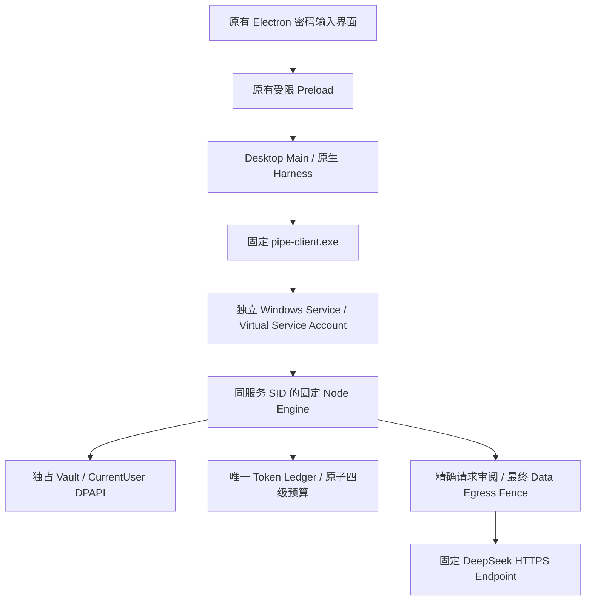

# M1.8.3 总体架构

本轮交付为可编译的独立服务实现和离线联调。生产 Vault / LIVE **BLOCKED**：尚未批准部署，尚无独立服务身份的真实拒绝证据。

Gateway 继续负责原有 Agent 授权、Context 重建、Router、Adapter 和 Harness 审计；新增 broker 分支委托凭证使用及预算核销，返回脱敏 ProviderResponse。没有重新实现 Model Gateway、Provider Adapter 或桌面页面。旧本地合成分支只在显式提供合成 protector/transport 时用于历史回归；普通 main 不会回退该分支。

Windows 服务为 `NT SERVICE\AgentNexusCredential`，无需为每类 Agent 建账户。代码、配置、资格与状态均固定到受保护目录。调用者检查真实 token、完整性、SID、进程句柄/创建时间与被保护镜像；不采信 JSON 的 peer/role/PID 声明。高完整性检查只是防御措施，不能独自替代服务 SID、DACL 或实际内存访问拒绝测试。

启动分两阶段：经独立批准并签名的 QUALIFICATION_ONLY 计划可在独立身份下测试**合成**凭证和 Fixture，无 HTTPS、qualified=false；生产 QUALIFIED 还须 11 项真实 Windows 证据全 PASS 与外部 CMS 签名。当前两阶段均未部署或激活。

入口：[服务设计](reports/credential-service-design.md)、[Windows 原生实现](reports/windows-service-design.md)、[IPC](reports/ipc-protocol.md)、[UI](reports/ui-integration.md)、[预算](reports/token-ledger-owner.md)、[资格](vault-qualification.json)、[部署审批](reports/deployment-approval.md)。
