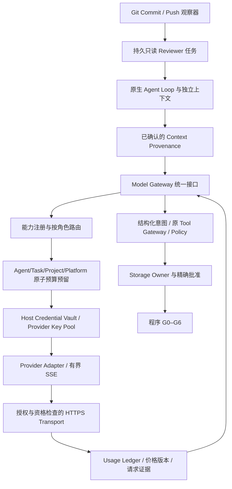

# AgentNexus M1.8 总体架构与实施边界

状态：实施中。基线为 M1.7 的 155 文件引擎，源码集 `8167ce3e78c602f43bee2b3a4d792a5054f76d7121a6a7730b14cc37eb5c4c6c`。根目录旧产品和 M0–M1.7 历史交付均不修改。

Vault、HTTP Transport、管理数据库与预算管理器仅属于可信 Host。普通 Agent 仅接收 complete 能力与原生消息/工具 facade，不持有 secret、管理 token、数据库、网络句柄。新增 Provider 不修改 Agent Loop；旧 MOCK 路径继续保持独立，兼容全部继承测试。真实与合成请求分开计量，模型切换不改身份、文件范围或工具权限。

关键实施顺序：冻结与复验 → 合成凭证加密和泄漏门 → 统一协议、三家 adapter、流式状态机 → 原子模型费用账本与路由 → 原生 harness 接缝 → Git reviewer、模拟集成与独立审查 → 交付证据。真实试验依赖独立批准和生产隔离资格；当前不以授权代替 OS 资格。

M1.7 的固定 Pilot 检查器仅执行已登记 fixture，不能为任意真实模型生成的源码授予 PROCESS。真实代码执行 Pilot 继续等待隔离资格；本轮离线用合成协议响应验证接缝，并重跑原有完整 Pilot。

## 不得扩大的资格

同 Windows 用户进程可调用 CurrentUser DPAPI，因此密文落盘并不能证明 Worker 与 Host 的隔离。当前禁止更改账户、ACL、AppContainer，也不能解除既有 CPU/OS execution gate。真实 secret 导入保持 BLOCKED；合成凭证可验证加密、轮换、并发和泄漏门。Ubuntu Secret Service 只定义独立接口与关闭失败的未配置后端，不默认读用户密钥环。

Resident 采用原持久队列、事件等待和按需调用。24 小时验收仅接受真实墙钟 24 小时报告；短测试另计。Single/Multi 对照采用预先冻结的任务/代码/评估合同，没有真实样本时记 NOT_RUN，优越性记 INCONCLUSIVE。
