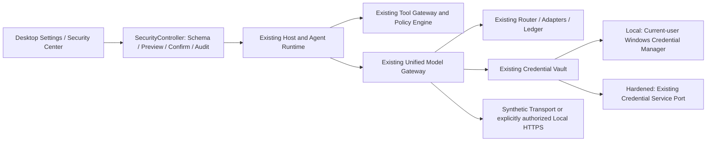

# Adaptive Security Architecture

M2.0 在 Q4.2 冻结源码之上增加统一 SecurityController、46 项 Security Feature Registry 和 Windows Credential Manager 适配器。两种模式共用 `openHarness`、NativeState、UnifiedModelGateway、ModelRouter、Provider Adapter、CredentialVault、ModelUsageLedger、CampaignTokenLedger、ToolGateway 和 PolicyEngine。没有复制第二套 Runtime、Gateway、Provider Registry 或账本。

Host 的可信管理对象能力不会进入 Agent/Subagent 的 `bindAgent()`。该 facade 只提供 complete；普通 Prompt、Tool 调用和伪造 role 字段无法调用管理接口。Renderer 仍使用固定本地 origin、CSP、sandbox、contextIsolation、sender 校验与有限 IPC allowlist；新 Key 只有 Local 后端条件满足时可保存。

配置版本是1，Schema、两个默认 Profile、注册表和依赖边均在 `source/config/agentnexus/security/`。运行时使用同一个严格语义校验器。独立 Feature Registry 是对已有能力的安全配置与状态投影；历史通用 Feature Registry 的142项目录不等于142项已实现。

配置审计与 NativeState/Context Archive 的恢复日志是固定边界。可选命令、工具、文件、Provider、消息、策略审计使用独立 producer 开关，关闭后不再产生相应附加记录；不会删掉已经存在的日志或使恢复日志断链。

本轮没有继续开发 TPM/CMS/Signer。Hardened 的服务接口与全部历史原件保留；远程 Profile 的预算/速率绑定尚未完成，因此整体派发保持 BLOCKED。没有把模拟服务、NOT_RUN 或历史 NO-GO 改成资格通过。
