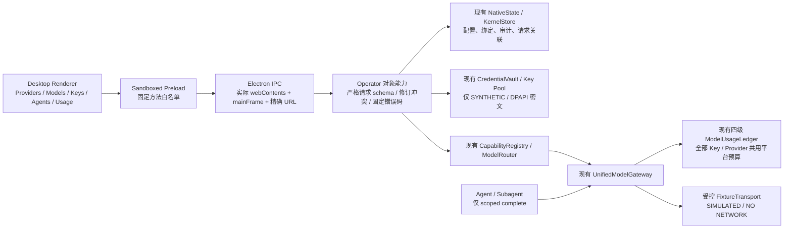

# AgentNexus Desktop：模型供应商管理架构

日期：2026-11-08。范围：Windows 本地桌面、供应商与模型管理、合成凭证 UI/IPC、现有模型引擎集成。**生产 Credential Service 与 LIVE BLOCKED。**

## 调查与技术选择

根产品仍为 M1.3 的本地内核，没有前端框架、桌面入口或现有视觉组件。M1.8、M1.8.1、M1.8.2 的后端以独立交付源码快照保存；本轮从 M1.8.2 `source/` 派生，保留历史原件和根产品，不把旧根源码当作最新 Gateway。

已核对 M1.8 架构、Vault/Key Pool、Gateway、CapabilityRegistry/ModelRouter、四级 Usage Ledger，以及 M1.8.1 验收和 M1.8.2 Vault、Data Egress、授权、验收与独立审查。M1.8.2 同 SID 子进程解密合成 Vault 的反例继续有效。根治理规则与政策未改变。

采用 Electron 45.2.3（官方稳定版本页于本轮核对），原生 Node/SQLite 后端，沙箱化 HTML/CSS/ES modules Renderer。无需另造 HTTP 管理服务，无浏览器 localhost 监听，无前端 Mock API。新增 TypeScript Host 由固定 TypeScript 5.9.3 转译；新界面没有 React 等框架依赖。Electron/Playwright 版本固定在 package-lock 中。桌面不是单独发布的网站。

## 数据与能力边界

Renderer 不持有 Node、文件系统、数据库、Vault 管理能力、网络 transport 或已有 Key。Preload 仅开放白名单 invoke，不暴露 ipcRenderer。Main 通过对象身份验证窗口与主 frame，拒绝第二窗口、子 frame、错误 URL 与载荷自称的 operator/admin。这里是 Electron 桥接认证，**不等于 OS Host/Worker 隔离资格**。

界面 origin 为 `agentnexus://desktop/index.html`。协议只服务三个固定资源；无任意文件路径路由。CSP 禁止 connect/frame/object、外部脚本和表单导航；Node integration 关闭，context isolation/sandbox/web security 开启，下载、权限、导航和新窗口默认拒绝。Chromium profile 位于同一固定数据根；UI 无 LocalStorage/IndexedDB 写入。

## 功能组织

- 统一导航包含 Dashboard、Agents、Messages、Model Providers、Model Registry、Usage & Billing。未实现的 Projects/Reviews 等没有假页面或占位成功流程。
- Model Providers 使用左侧供应商列表、右侧 Connection/Models/API Key Pool。Registry 来自 `config/agentnexus/providers.json`，Renderer 不维护另一套供应商列表。自定义 Provider 可配置名称、稳定 ID、HTTPS Base URL、协议和模型。
- OpenAI-compatible 复用已有 ChatProviderAdapter。Anthropic-compatible 与 Google Native 暂无相应适配器，选择项明确禁用；不宣称兼容。OpenAI、DeepSeek、GLM、OpenRouter 为可配置 preset，其配置存在不代表真实端点已联调。
- 只有 DeepSeek 官方目录条目沿用 M1.8.2 核验记录。模型来源 MANUAL/OFFICIAL_CATALOG/PROVIDER_RETURNED、验证状态 NOT_TESTED/SIMULATED/VERIFIED 分开。当前没有 LIVE 模型发现和账户权限验证；不伪造 Provider 返回目录。
- 模型增删、显示名、开关、上下文/输出上限、能力和 Provider/全局默认保存到 Host。含 `/` 的真实 wire Model ID 映射为稳定内部 hash ID，现有 Registry/Vault 的 ID 合同保持不变；适配器装饰层仅在构建 wire 请求时还原 Model ID。
- Key 名称、备注、开关、轮换、删除、覆盖模型、使用量、请求/错误、并发和限流状态来自 Vault/账本。新增模型通过 Host-only `setModels` 同步新租约范围；没有读回秘密方法。
- 模型选择器支持分组、搜索、收藏、最近使用、Agent 默认和 Task 覆盖；Agent 路由表支持备用、自动路由、仅发送前失败切换和预算。Messages 使用相同 scoped completion，但当前只有本地合成响应，聊天消息仅驻内存。

## 路由、并发与恢复

`model_binding=desktop` 是稳定绑定，实际模型策略由 Host 持久配置转换为现有 ModelRouter。模型切换不修改 Agent Subject、工具、文件范围、父子能力或 Policy。

所有入口共享四个在途名额；UNKNOWN 保留名额。逻辑请求与最多三个 Gateway attempt 通过 `DESKTOP_REQUEST` 关联，原始 attempt 均进入现有审计/Usage Ledger。仅 `FAILED + NOT_SENT` 且无发送占用才允许按配置尝试备用。SENT/UNKNOWN/INDETERMINATE 不自动切换或重放。Host 恢复既调用 Gateway.recover/ledger.recover，也将未完成逻辑请求转 INDETERMINATE。

关闭在途服务返回 HOST_BUSY，并保持 Host 可用；结果与账本持久化后才关闭 Harness/Vault。原生窗口会等待，成功关闭 Host 后退出。部署模型与进程身份没有因新增 UI 而获资格。

## 数据位置与预算

默认固定数据根为工作区 `.workflow-kit/runtime/AgentNexus-Model-Provider-UI/desktop-data/`；UI 无选择/重置数据库或 campaign 的入口。测试使用独立数据根，不能混作用户真实用量。

普通配置、模型、偏好、绑定与审计存入现有 KernelStore。Key 只写入合成 Vault 的 DPAPI 密文。系统固定路径优先 PowerShell 7，缺失时使用 Windows 自带 PowerShell，避免用户编辑环境变量。该 helper 与同 SID DPAPI 仍不构成生产隔离。

Global 显示现有 CampaignTokenLedger 的固定 100,000,000 输入+输出 Token 上限；当前真实使用 0，剩余 100,000,000。合成测试另计，全部 Provider/Key 共用同一四级平台账本。Key 数增加不改变预算。实际费用、缓存/推理缺失值使用 null/“—”，不把零估算冒充账单。该本地 Store 尚未取得生产唯一账本资格，后续部署必须钉定/迁移账本，不能把换库视作新授权。

## 交互研究与参考

仅参考公开交互组织，没有复制上游实现代码。

- [OpenCode Providers](https://opencode.ai/v2/docs/providers/)：目录、连接和自定义供应商分开组织。
- [OpenCode Models](https://opencode.ai/docs/models/)：模型选择与会话/默认配置的层次。
- [ZCode 官方模型配置指南](https://www.alibabacloud.com/help/en/model-studio/zcode-tool-guide)：模型设置中添加供应商、协议、Base URL、Key 与 Model ID。
- [ZCode FAQ](https://www.zcode.network/en/docs/qa/)：搜索结果说明桌面 Model Settings 入口；页面直接读取超时，未以未读内容补充事实。
- [Electron 稳定版本](https://releases.electronjs.org/?channel=stable)、[Electron Security](https://www.electronjs.org/docs/latest/tutorial/security)：版本、沙箱、context isolation、IPC sender 与自定义协议建议。
